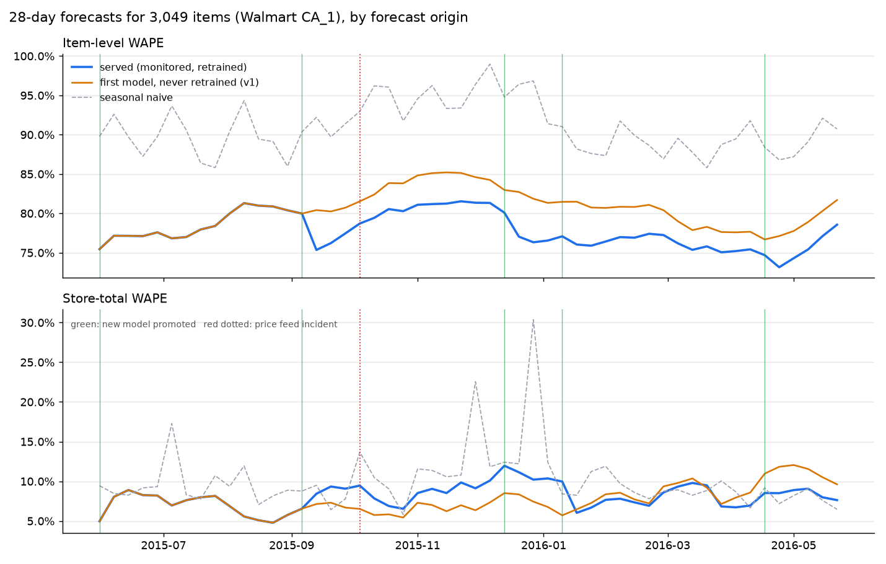
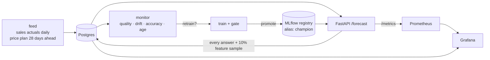
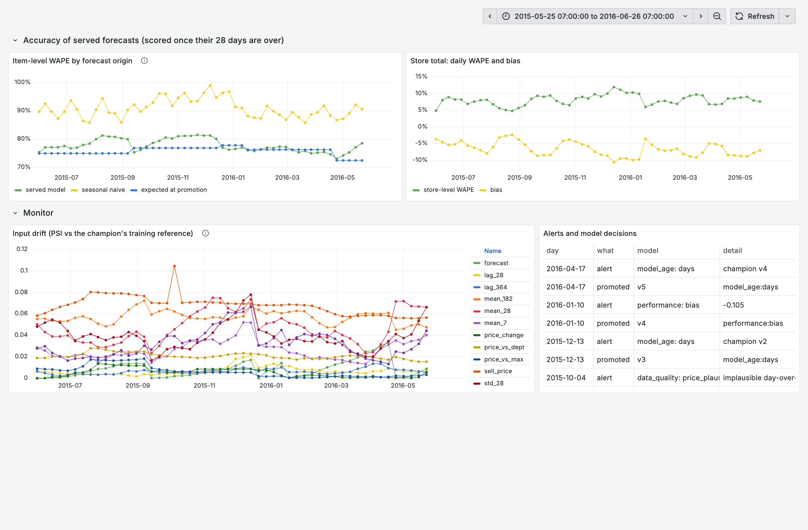
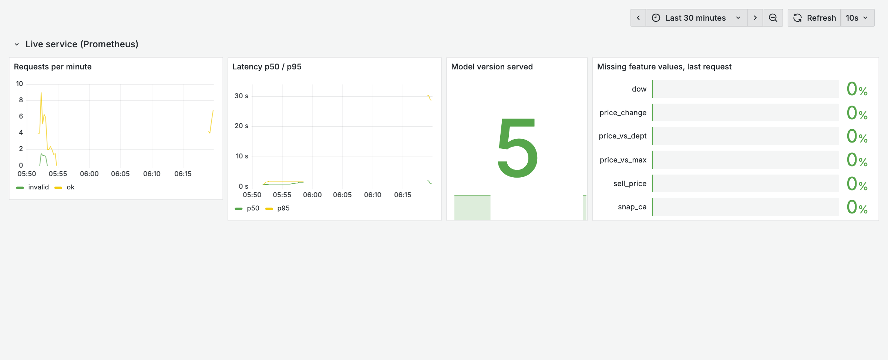

# Forecast model in production: serving, monitoring, retraining

[](https://github.com/dinulimann/mlops-forecast-serving/actions/workflows/ci.yml)

A demand forecasting model (LightGBM, 28 days ahead, 3,049 products of one
Walmart store from the [M5](https://mofc.unic.ac.cy/m5-competition/) data) is
put behind an API and operated for a simulated year. The interesting part is
what happens after deployment:

- a monitor checks data quality, input drift, accuracy and model age;
- a gate decides whether a retrained model may replace the one in service;
- the API swaps models without a restart;
- every decision is visible in Grafana.

The year is replayed week by week against the running stack, with real sales
and one injected upstream incident. The README reports what the system
caught, what it missed, and what that cost.



## Results of the replayed year

52 weekly forecasts (31 May 2015 – 22 May 2016), each scored on the 28 days
that followed. WAPE = sum of absolute errors / sum of actual units (lower is
better).

| | Item-level WAPE | Store-total WAPE |
|---|---:|---:|
| **Served: monitored, retrained 4 times** | **0.778** | 8.1% |
| First model, never retrained | 0.803 | **7.7%** |
| Seasonal naive (repeat last week) | 0.909 | 10.1% |

- **Each retrained model beat the frozen one on items.** WAPE was 4–6% lower
  in every period a new model served. Stores and products drift (new items,
  seasonality, prices), and a model trained on recent data tracks them better.
- **The store total is less flattering.** Averaged over the year, the frozen
  model was slightly better (7.7% vs 8.1%). The retrained models
  under-forecast the total by 7–10%. That error is visible in the dashboard and
  is the next thing to work on (see [Limits](#limits)).
- **Item-level WAPE near 0.78 is normal for this data.** Most products sell a
  few units a day with many zero days. The store total, which planning uses,
  is accurate to about 8%.

### What the monitor caught

| Date | Trigger | Action | Result |
|---|---|---|---|
| 6 Sep 2015 | model age > 91 days | retrain, gate passed | v2 promoted (gate WAPE 0.769 vs champion 0.813) |
| **4 Oct 2015** | **data quality: implausible prices** | **feed re-delivered, forecast re-issued** | see below |
| 13 Dec 2015 | model age | retrain | v3 promoted |
| 10 Jan 2016 | **store-level bias −10.5%** | retrain | v4 promoted (0.764 vs 0.801) |
| 17 Apr 2016 | model age | retrain | v5 promoted (0.726 vs 0.758) |

**The incident.** On 4 Oct the price plan for the largest department
(FOODS_3, 823 items) arrived in cents instead of dollars, a classic upstream
unit bug.
- The data quality rule caught it the same day, before any of the affected
  forecasts could be checked against actuals: 27% of items had a day-over-day
  price change beyond ×5.
- The drift check alone would not have raised an alert. The `sell_price` PSI
  was 0.105, only a warning, because the bad prices covered the last 7 of 28
  forecast days.
- Of the forecast as first served, the affected rows (5,761 item-days) were
  5.1% too low in total, with single items off by up to 11 units. After the
  re-delivery the forecast was re-issued. Retraining is blocked while a data
  quality alert is open, so the bad prices never reached a model.

### A rule that was added after the first replay

The first replay ([`docs/run1/`](docs/run1)) treated bias above 10% only as a
warning:
- v3 under-forecast the store total by 10–14% for 11 weeks;
- the monitor warned every week;
- nothing happened until the age rule retrained on 20 March.

[`tools/what_if_bias_rule.py`](tools/what_if_bias_rule.py) trained the model
that an alert on the first warning (10 Jan) would have produced. It passed the
same gate, and over those 10 weeks it would have cut store-level WAPE from
12.1% to 7.5% ([csv](docs/what_if_bias_rule.csv)). Bias became an alert. The
second replay, reported above, fired it on 10 Jan. From then to May,
store-level WAPE was 8.0% instead of 9.8% in the first replay, with
item-level accuracy unchanged.

## Architecture



| | |
|---|---|
| `mlops/features.py` | One `load_frame` + `build` used by **both** training and serving, so features cannot diverge. Every sales feature is lagged ≥ 28 days. |
| `mlops/train.py` | Trains a challenger with data up to origin−28 and scores it on the last 28 days against **what the champion actually served** for that window (read back from the prediction log). It is promoted only if it beats the seasonal naive and is within 1% of the champion. The promoted model is refit on all data, registered in MLflow with a reference profile of its inputs, and gets the `champion` alias. |
| `service/app.py` | Serves the `champion` version and polls the alias, swapping without a restart. Rejects requests it cannot answer honestly: 409 if actuals or the price plan for the window are not in yet, 404 for unknown items. Logs every forecast and the exact feature rows for a fixed 10% sample of items. Exposes Prometheus metrics. |
| `mlops/monitor.py` | **Data quality:** complete days, no negative sales, plausible day-over-day prices. **Input drift:** PSI per feature against the champion's reference. **Accuracy:** each forecast scored once its 28 days are over, against the gate's expectation and the naive. **Model age.** It retrains on an accuracy, bias, drift or age alert, never while a data quality alert is open, with a 28-day cooldown. Results are append-only. |
| `mlops/replay.py` | The simulated year: feed → API request → monitor → (fix / retrain). |

## Dashboards

**Forecast quality** (Postgres, plotted by business date): accuracy per
forecast, drift per feature, and every alert and model decision.



**Forecast service** (Prometheus, last 30 minutes): requests, latency, model
version and missing feature values.



## Bugs found while building it

| Symptom | Cause | Fix |
|---|---|---|
| PSI 1.2 for `mean_7` on the day the model was trained (no drift possible) | Logged features went through JSON with 10 significant digits. Values like 1/7 sat exactly on a decile edge computed in float32 and moved one bin down. | Round before binning, log at full precision, and add a regression test (`tests/test_drift.py`). |
| Drift alert on `age` every single week | Days since an item's first sale grows by design | Not monitored, like calendar features |
| API OOM-killed on its first full-store request | MLflow 3's server starts 7 background job workers (~1.2 GB) that this setup does not use. With a 4 GB VM, there was no memory left. | `MLFLOW_SERVER_ENABLE_JOB_EXECUTION=false` and memory limits per container |
| API OOM-killed after 12 weeks of full-store requests | Each request allocates about 1.2M rows, and glibc arenas fragment | `MALLOC_ARENA_MAX=2`, `restart: unless-stopped`, and a client that waits and retries |
| The incident alert disappeared from the history | Re-running the monitor after the fix replaced the day's results | `monitor_results` is append-only |

## Run it

Requires Docker (about 3.5 GB RAM for the stack) and Python 3.13.

```bash
python -m venv .venv && .venv/bin/pip install -r requirements.txt httpx matplotlib pytest
.venv/bin/python -m mlops.prepare                 # M5 download (50 MB, SHA-256 checked), store CA_1
docker compose up -d --build                      # Postgres, MLflow, API, Prometheus, Grafana
.venv/bin/python -m mlops.replay                  # the year (about an hour: 5 trainings, 52 forecasts)
.venv/bin/python -m mlops.report                  # docs/results.csv, docs/accuracy.png
```

- API: http://localhost:8090/docs, for example
  `curl -X POST localhost:8090/forecast -d '{"origin":"2016-05-22","ids":["FOODS_3_090_CA_1"]}' -H 'content-type: application/json'`
- MLflow: http://localhost:5050
- Grafana: http://localhost:3300

Tests: `pytest` runs 8 tests. They cover:
- no future sales leak into any feature;
- 371 days of history are enough and one day fewer is not;
- a request for a few items gets the same features as the whole store;
- the PSI JSON round trip, prices in cents, and NULLs.

CI runs them, then a 10-week replay with the incident against the real stack,
and checks the outcome (`tools/e2e_check.py`).

## Limits

- **The gate looks at one 28-day window.** v2 and v3 both won their gate, then
  under-forecast the store total for months. A gate on several windows, or
  correcting the store-level bias directly (reconciliation, or a scale factor
  from recent errors), is the obvious next step.
- **Time is simulated.** The API, registry, monitor and training are real and
  run against each other, but the replay plays the scheduler. In production
  the weekly loop would be a cron job or an Airflow DAG.
- **One store.** Feature loading takes about 1 s for a request of a few items
  and 10–12 s for the whole store (85k rows). It computes department average
  prices and first-sale dates in SQL per request. Several stores would need
  those precomputed.
- **Point forecasts only.** There are no prediction intervals in the API. The
  [earlier project](https://github.com/dinulimann/demand-forecasting) built
  them for the same data.
- **No authentication on the API, and MLflow uses SQLite.** Fine for one
  machine. A shared deployment needs both changed.
